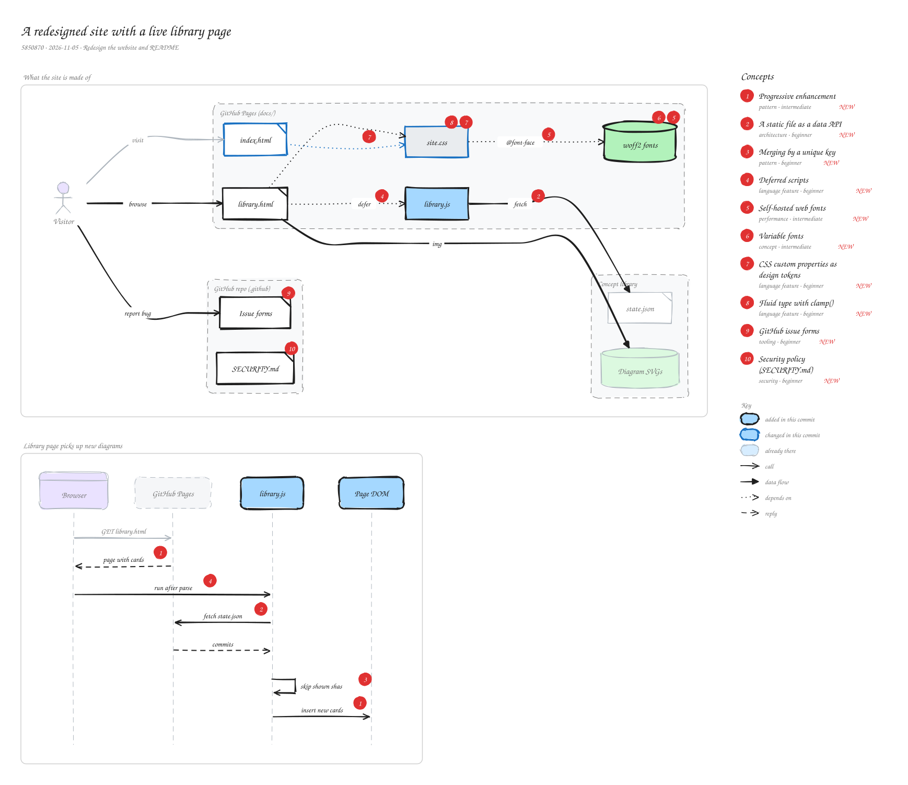

# A redesigned site with a live library page

`5850870` · 2026-11-05 · Redesign the website and README

The project website gets a new look with self-hosted variable fonts, design tokens and fluid type, plus a new library page. That page ships with the existing diagrams already in the HTML, then a small deferred script fetches docs/concepts/state.json and adds any diagram it doesn't already show, so new commits appear without hand-editing the page. The repository also gains GitHub community files: issue forms, a security policy and a code of conduct.

_Views: What the site is made of (architecture) · Library page picks up new diagrams (sequence). Numbered markers on the diagram match the concepts below. Edit it by opening `concepts.excalidraw` in [excalidraw.com](https://excalidraw.com), Obsidian, or the VS Code Excalidraw extension._

## Concepts

### 1. [Progressive enhancement](../../notes/progressive-enhancement.md) ✦ new

_pattern · intermediate_

Ship a page that already works as plain HTML, then let JavaScript add extras on top. If the script fails or is blocked, the visitor still gets the core content.

**Why here:** The library page lists the known diagrams in its HTML and only uses the script to add newer ones from state.json, so it never shows an empty grid.

**On the diagram:** "page with cards", "insert new cards"

**Files:** `docs/library.html`, `docs/library.js`

### 2. [A static file as a data API](../../notes/static-json-as-api.md) ✦ new

_architecture · beginner_

A static site has no server code, but it can still fetch JSON files hosted next to it. A file the build or a tool keeps up to date becomes a read-only API.

**Why here:** concepts-mcp already writes state.json for every diagram, so the page reads it directly instead of needing a backend or a rebuild.

**On the diagram:** "fetch", "fetch state.json"

**Files:** `docs/library.js:16-21`

### 3. [Merging by a unique key](../../notes/dedupe-by-key.md) ✦ new

_pattern · beginner_

When combining two lists that may overlap, index one by a unique key and only add items from the other whose key isn't there yet.

**Why here:** Cards in the HTML carry data-sha; the script collects those and adds only commits with an unseen short SHA, so nothing appears twice.

**On the diagram:** "skip shown shas"

**Files:** `docs/library.js:18-22`

### 4. [Deferred scripts](../../notes/script-defer.md) ✦ new

_language feature · beginner_

A \<script defer\> downloads in parallel with parsing and runs after the HTML is parsed, in order. It doesn't block rendering and can safely query the finished DOM.

**Why here:** library.js needs the grid and the existing cards to be in the DOM before it looks for them.

**On the diagram:** "defer", "run after parse"

**Files:** `docs/library.html`

### 5. [Self-hosted web fonts](../../notes/self-hosted-webfonts.md) ✦ new

_performance · intermediate_

Serving fonts from your own site with @font-face instead of a font CDN: no third-party requests, no tracking, and it works offline. WOFF2 is the compressed format browsers prefer; font-display: swap shows fallback text until the font loads.

**Why here:** The site loads Manrope, DM Sans and DM Mono from docs/assets/fonts with font-display: swap, keeping visitors' requests on GitHub Pages.

**On the diagram:** "@font-face", woff2 fonts

**Files:** `docs/assets/site.css:1-4`

### 6. [Variable fonts](../../notes/variable-fonts.md) ✦ new

_concept · intermediate_

One font file that contains a continuous range of weights (or other axes). @font-face declares the range, e.g. font-weight: 200 800, and the browser picks any weight in it.

**Why here:** Manrope and DM Sans each ship as one variable file instead of a file per weight, which keeps the download small.

**On the diagram:** woff2 fonts

**Files:** `docs/assets/site.css:1-2`

### 7. [CSS custom properties as design tokens](../../notes/css-custom-properties.md) ✦ new

_language feature · beginner_

Variables declared in CSS (--ink: #17181f) and read with var(--ink). Defining colors and spacing once on :root keeps a design consistent and easy to change.

**Why here:** The new violet accent, ink, line and background colors are tokens that every component reuses.

**On the diagram:** site.css, index.html → site.css

**Files:** `docs/assets/site.css`

### 8. [Fluid type with clamp()](../../notes/fluid-typography.md) ✦ new

_language feature · beginner_

clamp(min, preferred, max) lets a size grow with the viewport (e.g. 7vw) but never go below or above set limits, replacing several media-query breakpoints.

**Why here:** The hero headline uses clamp(44px, 7vw, 78px) so it scales smoothly from phones to wide screens.

**On the diagram:** site.css

**Files:** `docs/assets/site.css`

### 9. [GitHub issue forms](../../notes/github-issue-forms.md) ✦ new

_tooling · beginner_

YAML files in .github/ISSUE\_TEMPLATE that turn a new issue into a form with labeled fields, dropdowns and required inputs, so reports arrive with the details maintainers need.

**Why here:** Bug reports ask what happened, the agent and versions, and invite a screenshot of a broken diagram.

**On the diagram:** Issue forms

**Files:** `.github/ISSUE_TEMPLATE/bug_report.yml`, `.github/ISSUE_TEMPLATE/config.yml`

### 10. [Security policy (SECURITY.md)](../../notes/security-policy.md) ✦ new

_security · beginner_

A file that tells people how to report a vulnerability privately instead of opening a public issue. GitHub links it from the repo's Security tab.

**Why here:** An MCP server runs on users' machines and reads their repositories, so a private reporting path matters.

**On the diagram:** SECURITY.md

**Files:** `.github/SECURITY.md`
