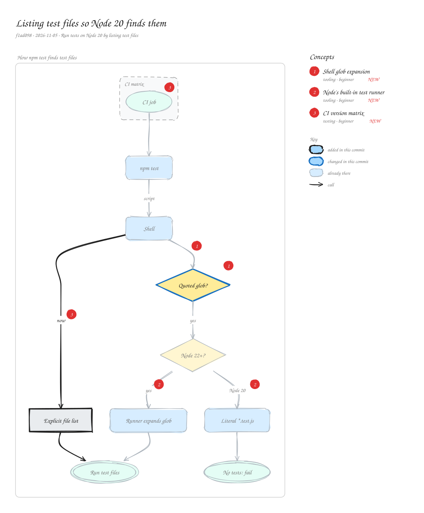

# Listing test files so Node 20 finds them

`f1ad098` · 2026-11-05 · Run tests on Node 20 by listing test files

The test script passed a quoted glob, "test/\*.test.js", to node --test. The quotes stop the shell from expanding it, and Node 22's test runner expands globs itself, but Node 20's doesn't: it looked for a file literally named \*.test.js, found none, and every Node 20 CI job failed. Listing the files explicitly works on every supported Node version.

_Views: How npm test finds test files (flow). Numbered markers on the diagram match the concepts below. Edit it by opening `concepts.excalidraw` in [excalidraw.com](https://excalidraw.com), Obsidian, or the VS Code Excalidraw extension._

## Concepts

### 1. [Shell glob expansion](../../notes/shell-glob-expansion.md) ✦ new

_tooling · beginner_

In a Unix shell, an unquoted pattern like test/\*.test.js is replaced by the matching file names before the program runs. Quoting it passes the pattern through unchanged, and then the program itself has to understand globs.

**Why here:** The quotes were there so Node's runner would expand the glob, which only Node 21+ does.

**On the diagram:** Shell → Quoted glob?, Quoted glob?

**Files:** `packages/concepts-mcp/package.json:16`

### 2. [Node's built-in test runner](../../notes/node-test-runner.md) ✦ new

_tooling · beginner_

node --test runs test files with node:test and node:assert, without a framework. Its features vary by Node version: glob patterns as arguments arrived in Node 21.

**Why here:** The package supports Node 20+, so the script has to work with Node 20's runner too.

**On the diagram:** "yes", "Node 20"

**Files:** `packages/concepts-mcp/package.json`

### 3. [CI version matrix](../../notes/ci-version-matrix.md) ✦ new

_testing · beginner_

Running the same CI job on several runtime versions at once, so a feature missing from the oldest supported version breaks the build instead of a user's install.

**Why here:** The Node 20 jobs in the matrix were what caught that the tests silently never ran there.

**On the diagram:** CI job, "now"

**Files:** `.github/workflows/ci.yml`
