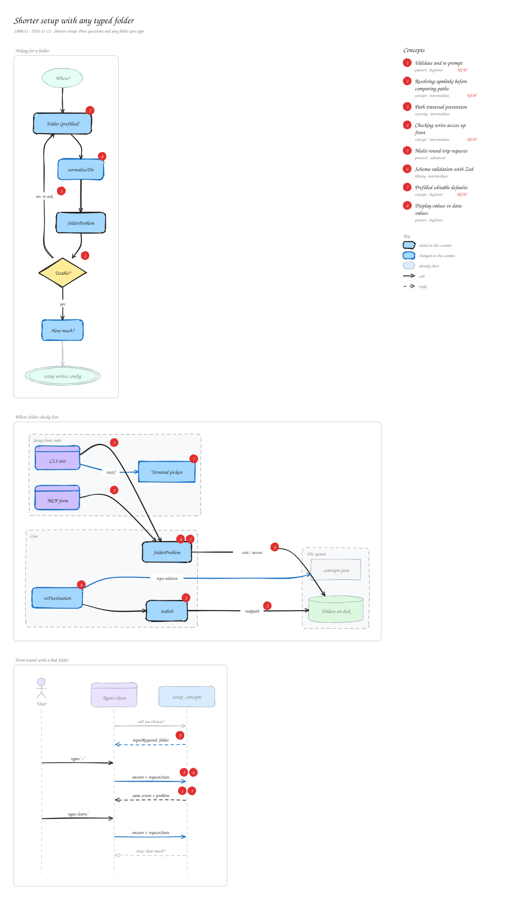

# Shorter setup with any typed folder

`1508c11` · 2026-11-12 · Shorter setup: three questions and any folder you type

Setup shrinks to three questions (where, which folder, how much) in both the terminal and the MCP form. The folder is free text with the default prefilled, so any repo or home folder works. Before anything is written, a typed folder is normalized (home-relative, symlinks resolved, stored repo-relative) and checked: the repo root, paths outside the repo, files and unwritable places are rejected with a short message and asked again. The MCP form shows one field per screen, carries earlier answers in requestState and re-validates them with zod on each round.

_Views: Asking for a folder (flow) · Where folder checks live (architecture) · Form round with a bad folder (sequence). Numbered markers on the diagram match the concepts below. Edit it by opening `concepts.excalidraw` in [excalidraw.com](https://excalidraw.com), Obsidian, or the VS Code Excalidraw extension._

## Concepts

### 1. [Validate and re-prompt](../../notes/input-validation-reprompt.md) ✦ new

_pattern · beginner_

Instead of failing when input is bad, check it right away, explain the problem in one line and ask the same question again with the previous answer kept so it can be fixed.

**Why here:** Users may type any folder; ones that can't be used (repo root, outside the repo, a file, unwritable) are asked again in both the CLI loop and the MCP form.

**On the diagram:** "no: re-ask", Usable?, "same screen + problem"

**Files:** `packages/concepts-mcp/src/cli.js`, `packages/concepts-mcp/src/server.js`

### 2. [Resolving symlinks before comparing paths](../../notes/symlink-resolution.md) ✦ new

_concept · intermediate_

Two different strings can name the same folder when a symlink is involved (on macOS /var is a link to /private/var). Comparing paths safely means resolving both with realpath first. For paths that don't exist yet, resolve the deepest existing ancestor and re-append the rest.

**Why here:** Absolute folders typed inside a temp repo looked like they were outside it until both sides were resolved.

**On the diagram:** realish, "realpath"

**Files:** `packages/concepts-mcp/src/core.js`

### 3. [Path traversal prevention](../../notes/path-traversal.md)

_security · intermediate_

Checking that a user-supplied path, once resolved, stays inside an allowed base folder, so '..' or absolute paths can't escape it.

**Why here:** Typed project folders are resolved against the repo and rejected if relative() starts with '..' or is empty.

**On the diagram:** folderProblem, CLI init → folderProblem, MCP form → folderProblem

### 4. [Checking write access up front](../../notes/preflight-permission-check.md) ✦ new

_concept · intermediate_

fs.access with W\_OK on the nearest existing ancestor tells you whether a folder could be created and written, before any files are touched. It's advisory (permissions can change), so the real write still handles errors.

**Why here:** Setup refuses folders it couldn't write to and says so, instead of failing halfway through writing.

**On the diagram:** "stat / access", folderProblem

**Files:** `packages/concepts-mcp/src/core.js`

### 5. [Multi-round-trip requests](../../notes/multi-round-trip-requests.md)

_protocol · advanced_

A tool call can return 'input required' plus opaque requestState; the client gathers the answer and calls again with both, so a stateless server runs a multi-step conversation.

**Why here:** The form now asks one field per screen and re-shows the folder screen when the typed folder fails the check.

**On the diagram:** "inputRequired: folder", "answer + requestState", "same screen + problem"

### 6. [Schema validation with Zod](../../notes/schema-validation.md)

_library · intermediate_

Declaring the shape of data once and parsing untrusted input against it, getting typed values or a clear error.

**Why here:** requestState comes back from the client, so earlier answers are re-validated with an answers schema each round.

**On the diagram:** "answer + requestState"

### 7. [Prefilled editable defaults](../../notes/prefilled-default.md) ✦ new

_concept · beginner_

Typing the default into the input line (readline's rl.write) lets the user press Enter to accept it or edit it in place, which is clearer than a hidden '\[default\]' hint.

**Why here:** The folder question shows docs/concepts or ~/Desktop/ConceptLibrary already typed in.

**On the diagram:** Folder (prefilled), Terminal pickers

**Files:** `packages/concepts-mcp/src/picker.js`

### 8. [Display values vs data values](../../notes/display-vs-data.md)

_pattern · beginner_

Store values in a canonical form and convert only when showing them.

**Why here:** Absolute repo paths are stored repo-relative and home paths as ~/..., so the committed config is portable.

**On the diagram:** toDestination, normalizeDir
