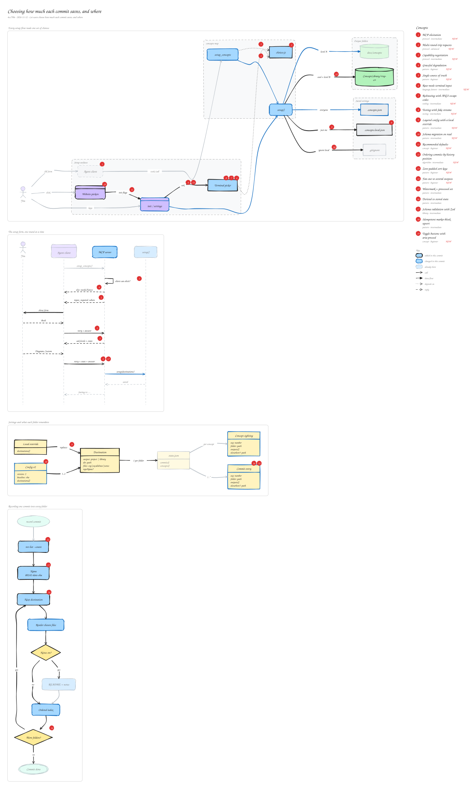

# Choosing how much each commit saves, and where

`4cc790e` · 2026-11-12 · Let users choose how much each commit saves, and where

Setup now offers detail levels (Diagram, Editable, Diagram + notes, Custom) for each output folder, and can save to the project, the learning library, or both. Every setup flow uses the same choices from choices.js: arrow-key pickers in the CLI, MCP elicitation forms (asked one round at a time, carrying earlier answers in requestState) with a fallback where the agent asks, and pickers on the website. Settings can change any time, for everyone in .concepts.json or just for you in a gitignored .concepts.local.json; a new or moved folder is seeded with the processed commits and concept ids. Commit folders and the index are numbered by git rev-list --count, so commits from the same day stay in order.

_Views: Every setup flow reads one set of choices (architecture) · The setup form, one round at a time (sequence) · Settings and what each folder remembers (data model) · Recording one commit into every folder (flow). Numbered markers on the diagram match the concepts below. Edit it by opening `concepts.excalidraw` in [excalidraw.com](https://excalidraw.com), Obsidian, or the VS Code Excalidraw extension._

## Concepts

### 1. [MCP elicitation](../../notes/mcp-elicitation.md) ✦ new

_protocol · intermediate_

An MCP server can ask the user for structured input through the client: it sends a message plus a small JSON Schema (strings, numbers, booleans, enums), and the client shows a native form and returns accept, decline or cancel.

**Why here:** setup\_concepts shows the where and level pickers as forms in the agent's own UI instead of relying on the model to phrase the question.

**On the diagram:** "input\_required: where", Agent client

**Files:** `packages/concepts-mcp/src/server.js:pickerRound`

### 2. [Multi-round-trip requests](../../notes/multi-round-trip-requests.md) ✦ new

_protocol · advanced_

Instead of the server calling back into the client mid-request, a handler returns 'input required' with the questions and an opaque requestState. The client gathers the answers and retries the same call with them, so the server can stay stateless between rounds.

**Why here:** Each round only brings back the latest answers, so earlier ones (where, levels) ride along in requestState until setup has everything.

**On the diagram:** "retry + answer", "ask levels + state", "retry + state + answer"

**Files:** `packages/concepts-mcp/src/server.js`

### 3. [Capability negotiation](../../notes/capability-negotiation.md) ✦ new

_protocol · intermediate_

At connection (or per request) the client declares which optional features it supports. A server checks those capabilities before using a feature, rather than finding out from an error.

**Why here:** The server reads the client's elicitation capability (from the request envelope or the initialize handshake) to decide between a form and the fallback.

**On the diagram:** "client can elicit?"

**Files:** `packages/concepts-mcp/src/server.js:canElicit`

### 4. [Graceful degradation](../../notes/graceful-degradation.md) ✦ new

_pattern · beginner_

When a richer feature isn't available, fall back to a simpler path that still gets the job done instead of failing.

**Why here:** Clients without forms get needsChoices with the same questions, and the agent asks them with its own multiple-choice tool.

**On the diagram:** "else: needsChoices"

**Files:** `packages/concepts-mcp/src/server.js:questionsForAgent`

### 5. [Single source of truth](../../notes/single-source-of-truth.md) ✦ new

_pattern · beginner_

Define each piece of knowledge in one place and derive every other use from it, so copies can't drift apart.

**Why here:** The options, their order, descriptions and the recommended default live in choices.js; the terminal picker, MCP form and agent questions all read it.

**On the diagram:** choices.js, Terminal picker → choices.js, setup\_concepts → choices.js

**Files:** `packages/concepts-mcp/src/choices.js`

### 6. [Raw-mode terminal input](../../notes/raw-mode-terminal.md) ✦ new

_language feature · intermediate_

A terminal normally buffers input until Enter. setRawMode(true) delivers each key immediately, and readline.emitKeypressEvents turns byte sequences like ESC \[ B into named keys such as 'down'. Raw mode must be switched off again, even on Ctrl-C.

**Why here:** The arrow-key pickers need single keypresses without adding a prompt library.

**On the diagram:** Terminal picker, "ask"

**Files:** `packages/concepts-mcp/src/picker.js:run`

### 7. [Redrawing with ANSI escape codes](../../notes/ansi-escape-redraw.md) ✦ new

_tooling · intermediate_

Escape sequences such as ESC\[3A (cursor up 3 lines) and ESC\[J (clear to end of screen) let a program redraw part of the terminal in place. It only works if you know exactly how many rows you drew, so lines must never wrap.

**Why here:** Each keypress redraws the picker in place, and rows are trimmed to the terminal width so a wrapped line can't break the redraw.

**On the diagram:** Terminal picker

**Files:** `packages/concepts-mcp/src/picker.js:row`

### 8. [Testing with fake streams](../../notes/fake-stream-testing.md) ✦ new

_testing · intermediate_

Code that reads from stdin and writes to stdout can take the streams as parameters; tests pass in-memory PassThrough streams and write key sequences into them.

**Why here:** The picker tests type arrow keys, digits, Space and Enter into a PassThrough instead of needing a real terminal.

**On the diagram:** Terminal picker

**Files:** `packages/concepts-mcp/test/levels.test.js`

### 9. [Layered config with a local override](../../notes/layered-config.md) ✦ new

_pattern · intermediate_

A committed config holds the team default; a personal, gitignored file on top of it can override parts of it for one person, like .env.local or settings.local.json.

**Why here:** One teammate can save only to their Desktop library with every file while the repo keeps the shared, lighter setting.

**On the diagram:** "just me", "replaces", .concepts.local.json

**Files:** `packages/concepts-mcp/src/config.js:readConfig`

### 10. [Schema migration on read](../../notes/migration-on-read.md) ✦ new

_pattern · intermediate_

Version the stored format and convert old versions to the new shape as they're read, writing the new version only when something changes. Old files keep working without a migration step.

**Why here:** A version 1 .concepts.json becomes one destination that keeps writing every file, so upgrading changes nothing until settings change.

**On the diagram:** Config v2

**Files:** `packages/concepts-mcp/src/config.js:readSharedConfig`

### 11. [Recommended defaults](../../notes/recommended-defaults.md) ✦ new

_concept · beginner_

Offer a few clear choices, mark one as recommended and preselect it, so pressing Enter (or --yes) gives a good result and more options stay one step away.

**Why here:** Every picker lists the simplest option first (Diagram, This project) and preselects it; Custom is there for people who want more.

**On the diagram:** "init flags", "ask"

**Files:** `packages/concepts-mcp/src/choices.js`

### 12. [Ordering commits by history position](../../notes/git-generation-number.md) ✦ new

_algorithm · intermediate_

git rev-list --count \<sha\> counts the commits reachable from a commit. A commit always counts higher than every ancestor, so the number orders commits by history even when timestamps tie, are rebased or come from skewed clocks.

**Why here:** Several commits a day had sorted by random hash; the count now prefixes folders and orders the index.

**On the diagram:** rev-list --count, Commit entry

**Files:** `packages/concepts-mcp/src/git.js:commitSeq`

### 13. [Zero-padded sort keys](../../notes/zero-padded-sort-keys.md) ✦ new

_pattern · beginner_

File browsers sort names as text, where '10' comes before '9'. Padding numbers to a fixed width ('00009', '00010') makes text order match number order.

**Why here:** Commit folders start with a 5-digit sequence number so they list in commit order anywhere.

**On the diagram:** Name 00142-date-sha

**Files:** `packages/concepts-mcp/src/library.js:commitFolder`

### 14. [Fan-out to several outputs](../../notes/fan-out-writes.md) ✦ new

_pattern · beginner_

One input is processed once and written to several destinations, each with its own options.

**Why here:** One record\_commit\_concepts call writes to every configured folder at that folder's level, each with its own state and index.

**On the diagram:** Next destination, More folders?

**Files:** `packages/concepts-mcp/src/core.js:record`

### 15. [Watermark + processed set](../../notes/processed-set.md)

_pattern · intermediate_

Track a starting point plus the set of items already handled, so work is never skipped or repeated.

**Why here:** A new or moved folder is seeded with the processed commits from an existing one, and pending work is the union across folders, so nothing is redone.

**On the diagram:** "seed + level B"

**Files:** `packages/concepts-mcp/src/core.js:seeded`

### 16. [Derived vs stored state](../../notes/derived-state.md)

_pattern · intermediate_

Compute facts from data you already keep instead of storing a second copy that can drift.

**Why here:** Former output folders aren't stored anywhere new: they're derived from the elsewhere field of seeded commits, so commits that only touch them are still skipped.

**On the diagram:** Commit entry

**Files:** `packages/concepts-mcp/src/core.js:pending`

### 17. [Schema validation with Zod](../../notes/schema-validation.md)

_library · intermediate_

Describe the shape of data once with Zod and validate untrusted input against it.

**Why here:** requestState comes back through the client, so earlier answers are re-validated with a Zod schema before setup uses them.

**On the diagram:** "retry + state + answer"

**Files:** `packages/concepts-mcp/src/server.js:flowState`

### 18. [Idempotent marker-block upsert](../../notes/idempotent-upsert.md)

_pattern · intermediate_

Change a file only if the content isn't already there, so running the same step twice gives the same result.

**Why here:** .concepts.local.json is added to .gitignore only when no matching line exists.

**On the diagram:** "ignore local"

**Files:** `packages/concepts-mcp/src/config.js:ignoreLocalConfig`

### 19. [Toggle buttons with aria-pressed](../../notes/aria-pressed-toggles.md) ✦ new

_concept · beginner_

A button that stays on or off announces its state to screen readers through aria-pressed="true"/"false"; CSS can style the pressed state from the same attribute.

**Why here:** The website's Where and Detail pickers are groups of toggle buttons that also drive the init command shown.

**On the diagram:** Website pickers

**Files:** `docs/install.js`, `docs/index.html`
