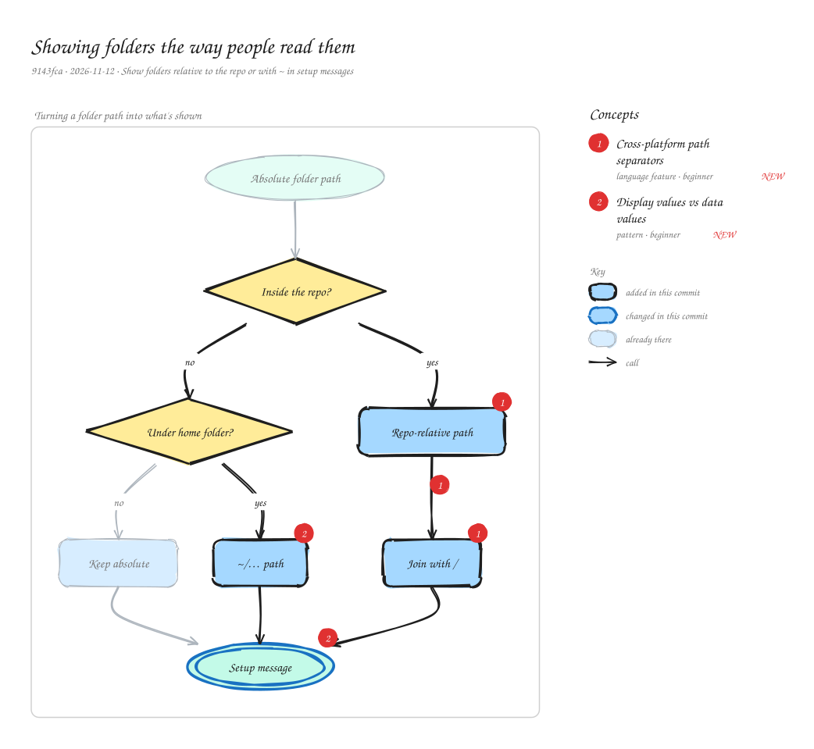

# Showing folders the way people read them

`9143fca` · 2026-11-12 · Show folders relative to the repo or with ~ in setup messages

Setup and settings printed absolute folder paths, which were long and, on Windows, used backslashes, so the tests' forward-slash expectations failed there. A small helper now shows a folder relative to the repository when it's inside it (docs/concepts, always with forward slashes) and with ~ for the home folder otherwise. Every message (setup summary, seeding, folders left behind, status) uses it, while the absolute paths stay in the structured result for programs.

_Views: Turning a folder path into what's shown (flow). Numbered markers on the diagram match the concepts below. Edit it by opening `concepts.excalidraw` in [excalidraw.com](https://excalidraw.com), Obsidian, or the VS Code Excalidraw extension._

## Concepts

### 1. [Cross-platform path separators](../../notes/cross-platform-paths.md) ✦ new

_language feature · beginner_

Windows separates path parts with \\ and macOS/Linux with /. Node's path module uses the current platform's separator (path.sep), so the same code produces different strings on each OS. Paths shown to people or compared in tests are often normalized to / first.

**Why here:** Project folders are now shown as repo-relative paths joined with /, so messages read the same everywhere and the Windows CI jobs pass.

**On the diagram:** Repo-relative path → Join with /, Join with /, Repo-relative path

**Files:** `packages/concepts-mcp/src/core.js:shownDir`, `packages/concepts-mcp/src/config.js:outputDirInRepo`

### 2. [Display values vs data values](../../notes/display-vs-data.md) ✦ new

_pattern · beginner_

Keep the precise value for programs (an absolute path) and derive a separate, friendlier form for people (docs/concepts, ~/ConceptLibrary). Formatting for display shouldn't change the data other code relies on.

**Why here:** The structured result still carries absolute paths; only the messages use the shown form.

**On the diagram:** Setup message, ~/… path

**Files:** `packages/concepts-mcp/src/server.js:setupSummary`, `packages/concepts-mcp/src/cli.js:printSaved`
